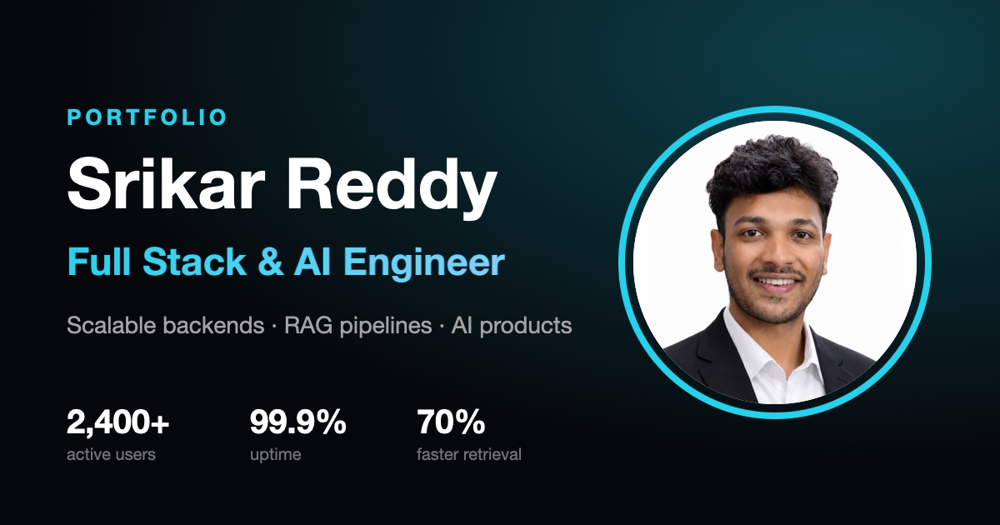

# Srikar Reddy · Portfolio

Personal portfolio of **Srikar Reddy**, Full Stack & AI Engineer based in Hyderabad, India.

**Live:** https://srikarreddyy.vercel.app



## Highlights

- **StaySync**: multi-tenant hostel management platform, 2,400+ active users, 99.9% uptime
- **Multi-Doc Reasoning Engine**: RAG pipeline with source citations, 70% lower retrieval latency
- **Smart Crowd Management**: real-time YOLOv8 + TensorRT computer vision on AWS

## Tech stack

- [React 18](https://react.dev) + [Vite](https://vitejs.dev)
- [Tailwind CSS](https://tailwindcss.com) for styling
- [Framer Motion](https://www.framer.com/motion/) for animation (respects `prefers-reduced-motion`)
- [EmailJS](https://www.emailjs.com) for the contact form
- [Vercel Analytics](https://vercel.com/analytics)

## Running locally

```bash
npm install
cp .env.example .env.local   # add your EmailJS IDs
npm run dev                  # http://localhost:5173
```

| Script            | What it does                 |
| ----------------- | ---------------------------- |
| `npm run dev`     | Start the dev server         |
| `npm run build`   | Production build to `dist/`  |
| `npm run preview` | Serve the production build   |
| `npm run lint`    | Lint with ESLint             |

## Project structure

```
src/
├── constants/index.js   # all content: profile, projects, experience, education
├── Sections/            # Navbar, Hero
├── Components/          # Skills, Experience, Projects, Education, Contact, Footer
│   └── ui/              # shared Section, Socials, motion presets
└── assets/projects/     # project illustrations (SVG)
```

To update content, edit `src/constants/index.js`. No component changes needed.

## Environment variables

| Variable                   | Description          |
| -------------------------- | -------------------- |
| `VITE_EMAILJS_SERVICE_ID`  | EmailJS service ID   |
| `VITE_EMAILJS_TEMPLATE_ID` | EmailJS template ID  |
| `VITE_EMAILJS_PUBLIC_KEY`  | EmailJS public key   |

Set them in `.env.local` locally and in **Vercel → Project → Settings → Environment Variables** for production.
